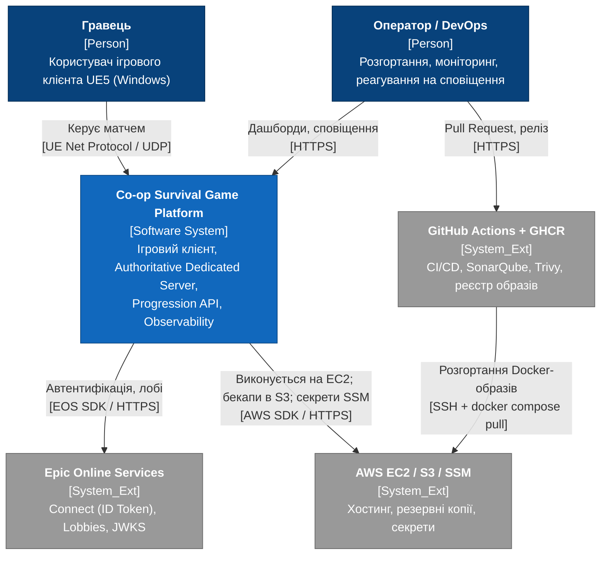
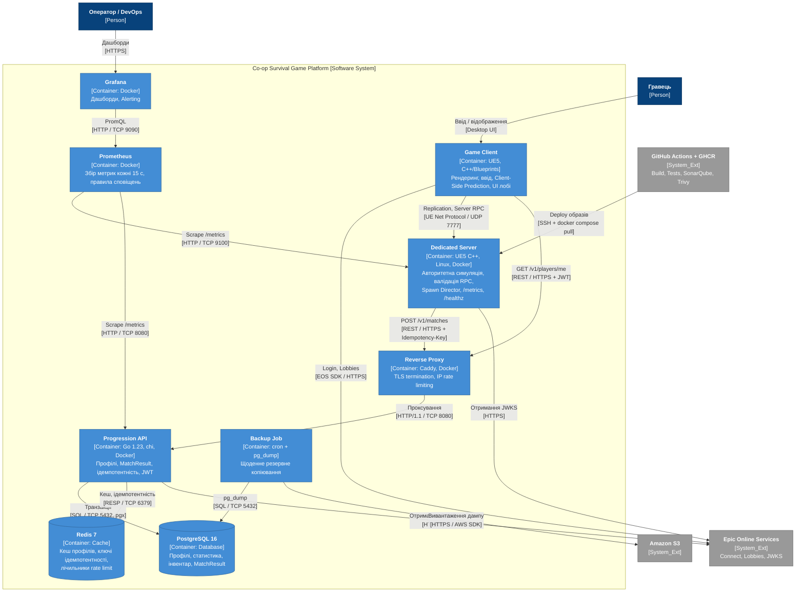
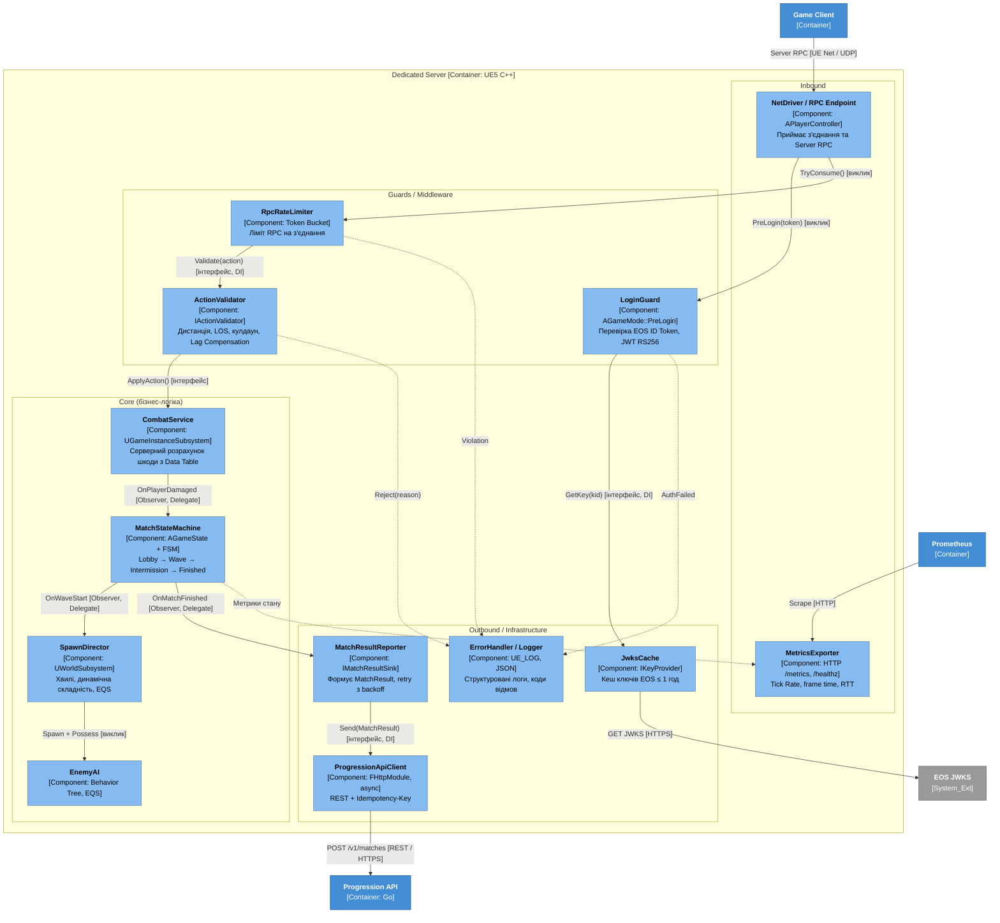

# 2 ПРОЄКТУВАННЯ АРХІТЕКТУРИ СИСТЕМИ

Архітектуру системи змодельовано за методологією C4 Model (Simon Brown) на трьох рівнях: System Context, Container та Component. Діаграми виконано за принципом Diagrams-as-Code у Mermaid.js із нотацією C4 (Person, Software System, Container, Component, System_Ext). Вимоги, на які посилаються описи, наведено у специфікації [srs.md](srs.md), архітектурні рішення – у каталозі [adr/](adr/).

## 2.1 Контекстне та контейнерне моделювання системи (C4 Model)

### 2.1.1 Рівень 1 – System Context

Рисунок 2.1 – Діаграма контексту системи (C4 Level 1)

Опис елементів діаграми:

| Елемент | Тип | Роль | Протокол взаємодії |
|---|---|---|---|
| Гравець | Person | Керує ігровим клієнтом, бере участь у матчі | UE Net Protocol / UDP |
| Оператор / DevOps | Person | Ініціює релізи через Pull Request, переглядає дашборди та сповіщення | HTTPS |
| Co-op Survival Game Platform | Software System | Система, що проєктується | – |
| Epic Online Services | System_Ext | Автентифікація (ID Token), лобі, JWKS ([SRS-FUN-06](srs.md#srs-fun-06), [SRS-FUN-08](srs.md#srs-fun-08)) | EOS SDK / HTTPS |
| AWS EC2 / S3 / SSM | System_Ext | Хостинг контейнерів, резервні копії ([SRS-NFR-REL-03](srs.md#srs-nfr-rel-03)), секрети ([SRS-NFR-SEC-02](srs.md#srs-nfr-sec-02)) | AWS SDK / HTTPS |
| GitHub Actions + GHCR | System_Ext | Конвеєр CI/CD ([SRS-FUN-15](srs.md#srs-fun-15)), реєстр образів | HTTPS; SSH для розгортання |

### 2.1.2 Рівень 2 – Container

Рисунок 2.2 – Контейнерна діаграма системи (C4 Level 2)

Опис контейнерів та трасування вимог:

- **Game Client** (UE5, C++/Blueprints) – рендеринг, обробка вводу, Client-Side Prediction, UI лобі. Реалізує [SRS-FUN-08](srs.md#srs-fun-08) та [SRS-FUN-09](srs.md#srs-fun-09). Взаємодіє з Dedicated Server через UE Net Protocol / UDP 7777, з EOS – через EOS SDK / HTTPS, з Progression API – через REST / HTTPS з JWT.
- **Dedicated Server** (UE5 C++, Linux, Docker) – авторитетна симуляція матчу. Реалізує [SRS-FUN-01](srs.md#srs-fun-01)–[SRS-FUN-07](srs.md#srs-fun-07), [SRS-FUN-16](srs.md#srs-fun-16), [SRS-FUN-17](srs.md#srs-fun-17); модель розміщення обґрунтовано в [ADR-001](adr/0001-choice-of-technology.md). Внутрішню структуру наведено в [C4 Component](#diagram-level3).
- **Reverse Proxy** (Caddy) – завершення TLS 1.2+ та обмеження частоти на рівні IP перед Progression API ([SRS-NFR-SEC-02](srs.md#srs-nfr-sec-02), [SRS-NFR-SEC-03](srs.md#srs-nfr-sec-03)).
- **Progression API** (Go 1.23, chi) – REST API профілів і результатів матчу з перевіркою JWT. Реалізує [SRS-FUN-10](srs.md#srs-fun-10)–[SRS-FUN-14](srs.md#srs-fun-14), вимоги [SRS-NFR-PERF-03](srs.md#srs-nfr-perf-03), [SRS-NFR-SEC-01](srs.md#srs-nfr-sec-01), [SRS-NFR-COMP-01](srs.md#srs-nfr-comp-01).
- **PostgreSQL 16** – транзакційне сховище профілів, інвентарю та MatchResult ([SRS-FUN-10](srs.md#srs-fun-10)); доступ через SQL / TCP 5432 (драйвер pgx).
- **Redis 7** – кеш профілів ([SRS-NFR-SCAL-02](srs.md#srs-nfr-scal-02)), ключі ідемпотентності з TTL 24 год ([SRS-FUN-11](srs.md#srs-fun-11)), лічильники rate limit ([SRS-NFR-SEC-03](srs.md#srs-nfr-sec-03)); протокол RESP / TCP 6379.
- **Prometheus** та **Grafana** – збір метрик з /metrics кожні 15 с та сповіщення ([SRS-FUN-16](srs.md#srs-fun-16), [SRS-NFR-OPS-01](srs.md#srs-nfr-ops-01)).
- **Backup Job** (cron + pg_dump) – щоденне резервне копіювання в Amazon S3 ([SRS-NFR-REL-03](srs.md#srs-nfr-rel-03)).

Усі контейнери описані в одному файлі Docker Compose та запускаються від непривілейованого користувача ([SRS-NFR-SEC-05](srs.md#srs-nfr-sec-05)); політика перезапуску та перевірки /healthz забезпечують [SRS-NFR-REL-01](srs.md#srs-nfr-rel-01).

## 2.2 Компонентне моделювання критичного сервісу системи

### 2.2.1 Рівень 3 – Component: Dedicated Server

Як критичний сервіс обрано контейнер Dedicated Server, оскільки він містить основне обчислювальне навантаження (симуляція, ШІ ворогів, реплікація) та всі механізми захисту від маніпуляцій клієнта.

Рисунок 2.3 – Діаграма компонентів Dedicated Server (C4 Level 3)

Компоненти згруповано за шарами Clean Architecture; залежності спрямовані від зовнішніх шарів до ядра, а ядро звертається до інфраструктури лише через інтерфейси (Dependency Inversion).

**Inbound (вхідний шар):**

- **NetDriver / RPC Endpoint** (APlayerController, Server RPC з атрибутом WithValidation) – приймає з'єднання та серверні RPC; не містить бізнес-логіки, передає запит у шар Guards.
- **MetricsExporter** – вбудований HTTP-ендпоінт /metrics та /healthz ([SRS-FUN-16](srs.md#srs-fun-16), [SRS-FUN-17](srs.md#srs-fun-17)); отримує значення від MatchStateMachine та ігрового циклу.

**Guards / Middleware:**

- **LoginGuard** (перевизначення AGameMode::PreLogin) – перевіряє EOS ID Token до створення PlayerController ([SRS-FUN-06](srs.md#srs-fun-06), [SRS-NFR-SEC-01](srs.md#srs-nfr-sec-01)); ключі отримує через інтерфейс IKeyProvider.
- **RpcRateLimiter** (UActorComponent, алгоритм Token Bucket) – обмежує частоту RPC на з'єднання та ініціює від'єднання при порушеннях ([SRS-FUN-04](srs.md#srs-fun-04), [SRS-NFR-SEC-03](srs.md#srs-nfr-sec-03)).
- **ActionValidator** (інтерфейс IActionValidator) – перевіряє дистанцію, лінію видимості з компенсацією затримки та кулдаун ([SRS-FUN-02](srs.md#srs-fun-02)).

**Core (бізнес-логіка):**

- **CombatService** (UGameInstanceSubsystem) – обчислює шкоду лише на сервері з параметрів Data Table ([SRS-FUN-03](srs.md#srs-fun-03)).
- **MatchStateMachine** (AGameState + скінченний автомат Lobby → Wave → Intermission → Finished) – зберігає авторитетний стан і реплікує його ([SRS-FUN-01](srs.md#srs-fun-01)); публікує події через делегати (патерн Observer).
- **SpawnDirector** (UWorldSubsystem) – генерує хвилі з динамічною складністю ([SRS-FUN-05](srs.md#srs-fun-05)).
- **EnemyAI** (Behavior Tree, EQS) – поведінка ворогів, що виконується лише на сервері.

**Outbound / Infrastructure:**

- **MatchResultReporter** (реалізація IMatchResultSink) – формує MatchResult та повторює відправку з експоненційною затримкою без блокування ігрового циклу ([SRS-FUN-07](srs.md#srs-fun-07), [SRS-NFR-REL-04](srs.md#srs-nfr-rel-04)).
- **ProgressionApiClient** (FHttpModule, асинхронні запити) – REST-клієнт із заголовком Idempotency-Key та сервісним ключем ([SRS-NFR-SEC-02](srs.md#srs-nfr-sec-02)).
- **JwksCache** (реалізація IKeyProvider) – кешує ключі EOS не довше 1 год ([SRS-NFR-SEC-01](srs.md#srs-nfr-sec-01)).
- **ErrorHandler / Logger** – централізована обробка відмов (Reject, Violation, AuthFailed) зі структурованими логами у форматі JSON.

Типи зв'язків: синхронні внутрішньопроцесні виклики (виклик), виклики через інтерфейси з впровадженням залежностей (інтерфейс, DI), події через делегати Unreal Engine (Observer, Delegate). Пунктиром позначено потоки помилок та телеметрії.

## 2.3 Документування архітектурних рішень (Architecture Decision Records)

| ID | Рішення | Статус |
|---|---|---|
| [ADR-001](adr/0001-choice-of-technology.md) | Модель розміщення авторитетного ігрового сервера: Dedicated Server у Docker на AWS EC2 | Approved |

## 2.4 Матриця трасування вимог

Таблиця 2.1 – Трасування вимог SRS в архітектурні елементи

| Вимога | Контейнер (C4 L2) | Компонент (C4 L3) | ADR |
|---|---|---|---|
| [SRS-FUN-01](srs.md#srs-fun-01) | Dedicated Server | MatchStateMachine | [ADR-001](adr/0001-choice-of-technology.md) |
| [SRS-FUN-02](srs.md#srs-fun-02) | Dedicated Server | ActionValidator | [ADR-001](adr/0001-choice-of-technology.md) |
| [SRS-FUN-03](srs.md#srs-fun-03) | Dedicated Server | CombatService | [ADR-001](adr/0001-choice-of-technology.md) |
| [SRS-FUN-04](srs.md#srs-fun-04) | Dedicated Server | RpcRateLimiter | [ADR-001](adr/0001-choice-of-technology.md) |
| [SRS-FUN-05](srs.md#srs-fun-05) | Dedicated Server | SpawnDirector, EnemyAI | – |
| [SRS-FUN-06](srs.md#srs-fun-06) | Dedicated Server | LoginGuard, JwksCache | – |
| [SRS-FUN-07](srs.md#srs-fun-07) | Dedicated Server | MatchResultReporter, ProgressionApiClient | – |
| [SRS-FUN-08](srs.md#srs-fun-08), [SRS-FUN-09](srs.md#srs-fun-09) | Game Client | – | – |
| [SRS-FUN-10](srs.md#srs-fun-10)–[SRS-FUN-14](srs.md#srs-fun-14) | Progression API, PostgreSQL, Redis | – | – |
| [SRS-FUN-15](srs.md#srs-fun-15) | GitHub Actions (зовнішня система) | – | – |
| [SRS-FUN-16](srs.md#srs-fun-16), [SRS-FUN-17](srs.md#srs-fun-17) | Dedicated Server, Prometheus | MetricsExporter | – |
| [SRS-NFR-PERF-01](srs.md#srs-nfr-perf-01), [SRS-NFR-SCAL-01](srs.md#srs-nfr-scal-01) | Dedicated Server | MatchStateMachine, SpawnDirector | [ADR-001](adr/0001-choice-of-technology.md) |
| [SRS-NFR-SEC-02](srs.md#srs-nfr-sec-02), [SRS-NFR-SEC-03](srs.md#srs-nfr-sec-03) | Reverse Proxy, Progression API | ProgressionApiClient, RpcRateLimiter | – |
| [SRS-NFR-REL-01](srs.md#srs-nfr-rel-01) | Dedicated Server (restart policy) | MetricsExporter (/healthz) | [ADR-001](adr/0001-choice-of-technology.md) |
| [SRS-NFR-REL-03](srs.md#srs-nfr-rel-03) | Backup Job | – | – |
